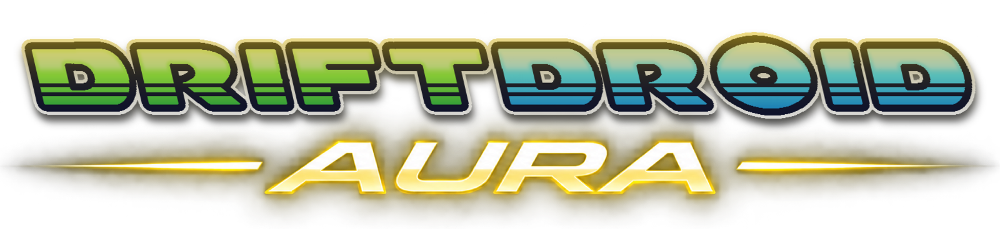

<p align="center">
  
</p>

<p align="center">
  <b>Mario Kart Wii as a native Android app - now with a mod browser, live rooms, a leaderboard and a Mii editor.</b>
</p>

---

**DriftDroid Aura** is a fork of [DriftDroid](https://github.com/dorPXP/driftdroid), the native
Android port of [WiiCompiled](https://github.com/patchzyy/Wiicompiled). The game itself is unchanged
from DriftDroid: it runs as statically recompiled ARM64 code - no emulator, no interpreter, no JIT.
What Aura changes is everything around the game. The launcher has been rebuilt from scratch and
picks up the features the [Wheel Wizard](https://github.com/TeamWheelWizard/WheelWizard) tool brings
to PC players: install mods from GameBanana in one tap, see who's racing on Retro WFC right now,
browse the VR leaderboard, and edit your Miis and licenses.

> [!IMPORTANT]
> There is no Nintendo code, no assets and no game data anywhere in this project or its releases.
> You need your own legally dumped copy of the **PAL** version of Mario Kart Wii. Nothing in this
> repo, in any release APK, or in the build process contains or downloads Nintendo IP.

Current version: **1.4.0-aura.1**, based on DriftDroid 1.4.0 (Retro Rewind 6.13.4).

## What's new in Aura

### A new launcher

A dark, full-screen launcher with a navigation rail - **Home, Mods, Rooms, Ranks, Profile,
Settings** - instead of a column of buttons. Home shows both games with their Play/Install buttons,
how many people are racing online, your racer, and your mods at a glance. Long jobs (installing
Retro Rewind, downloading a mod, importing a game pack) show their progress in a task bar that
follows you from page to page.

### Mods, without moving files around

- **Browse GameBanana** from inside the app: Mario Kart Wii mods by category (skins, tracks, UI,
  other) or by search, with screenshots, descriptions and download counts.
- **Install with one tap.** The file is downloaded and unpacked straight into the app - `.zip`,
  `.7z` and `.rar` (including RAR5) all work.
- **Manage what's installed**: turn mods on and off, drag them into priority order (the higher mod
  wins when two change the same file), delete them, or import an archive you already have.

Turned-on mods load the next time you start the game and apply to both Mario Kart Wii and Retro
Rewind. Mods that replace Retro Rewind's own menu or race files only work on the Retro Rewind
version they were made for.

### Rooms

Every public Retro WFC room, live: which track is being raced, who's in it with their Miis and
VR/BR, the room's average VR and whether it's open. It refreshes every 40 seconds while you're
looking, and you can search for a player by name or friend code. Tap anyone to copy their friend
code, add them as a friend, or open their profile. (Joining a room still happens inside the game.)

### Leaderboard

The top 100 players by VR, with a podium for the top three. Each player has a profile page with
their rank, VR, how it moved over the last day, week and month, and a chart of the last 7 days.
Look up any friend code to see where its owner stands.

### Profile and Mii editor

- **Licenses** from your saves (Mario Kart Wii and Retro Rewind keep separate ones): Mii, friend
  code, VR and BR, races and wins, and the friend list with pending requests. Change which Mii a
  license races as, or remove a friend.
- **Miis**: every Mii on the console, with an editor for every part - face, hair, eyebrows, eyes,
  nose, mouth, glasses, facial hair, mole, body and info - and a live picture. Make new Miis,
  duplicate, delete, and import or export single Miis (`.rcd`) or the whole Mii file.

Every change to your save or Mii file is checked, written with the correct checksum, and the
previous file is kept next to it as a `.bak`. If the game is still open in the background, the app
warns you first, because the game could write its own copy back over your change.

## Requirements

- **Android 10 (API 29) or newer** on a 64-bit ARM (`arm64-v8a`) phone. There is no 32-bit or x86
  build.
- A working Vulkan driver for the best experience. Devices without one can switch to OpenGL ES in
  **Settings → Graphics**.
- Enough free storage for the extracted game data (a few GB), plus about 2 GB for Retro Rewind.
- A clean, unmodified **PAL `RMCP01`** disc image of Mario Kart Wii (`.iso` or `.wbfs`), dumped by
  you. Other regions and modified executables are rejected.
- An internet connection for the online pages (Mods browser, Rooms, Leaderboard) and Retro Rewind
  downloads. Everything else works offline.

> [!NOTE]
> Nobody here will tell you where to get the game. Dumping your own disc is on you, and links to
> game files won't be provided or tolerated.

## Installing

Get the APK from this repository's [Releases](https://github.com/edgHD/driftdroid-aura/releases)
page. The app isn't on the Play Store.

1. Install the APK.
2. Open it and tap **Install with ISO/WBFS** on the Mario Kart Wii card, then pick your disc image.
   The first time, the app extracts the game's data on the phone.
3. For Retro Rewind, tap **Install** on its card - the app downloads it from Retro Rewind's own
   server, or takes a `.zip` or folder you already have.

To update DriftDroid Aura, install the new APK over the old one. Saves, the extracted game data,
Retro Rewind and your mods all stay.

> [!WARNING]
> **Coming from the official DriftDroid?** DriftDroid Aura uses the same app id but is signed with
> a different key, so Android won't install it over DriftDroid. Uninstalling DriftDroid deletes its
> data, so first export your saves (**Save data** in DriftDroid, or **Settings → Save data** here) and
> your Miis, then uninstall, install DriftDroid Aura, and import them again.

**Game packs (optional).** Release APKs contain the game code. DriftDroid Aura doesn't change it, so it
uses [DriftDroid Builder](https://github.com/dorPXP/driftdroid/releases) from the original project:
run the Builder of the matching DriftDroid version (1.4.0) on a PC, then import the pack with
**Settings → Import game pack**. A game pack is only needed for a newer Retro Rewind than the one
built in. The Builder is also how the original project makes its Switch version.

> [!CAUTION]
> Only install builds from this repository's own Releases page. Don't install an APK someone shared
> on Discord or a random download site.

## What the app connects to

Only when you use the feature that needs it:

| Service | Used for |
| --- | --- |
| `update.rwfc.net`, `cdn.update.rwfc.net` | Downloading and updating Retro Rewind |
| `rwfc.net` | Rooms and the Leaderboard (Retro WFC's public API, read-only) |
| `gamebanana.com` and its subdomains | Browsing and downloading mods (GameBanana's public API) |
| `studio.mii.nintendo.com` | Pictures of Miis. The Mii's appearance is sent to Nintendo's public Mii renderer. Turn **Settings → Mii pictures** off to use simple offline drawings instead |

Online play itself goes to the Retro WFC servers from inside the game, exactly as on a Wii or in
Dolphin. Nothing is collected by this project.

## Everything else, from DriftDroid

Aura keeps all of DriftDroid's game-side features:

- **Native rendering** through [aurora](https://github.com/encounter/aurora) on Vulkan (Dawn), with
  an **OpenGL ES fallback** for phones whose Vulkan driver is broken.
- **Touch controls** made for Mario Kart Wii - drag-anywhere steering, face buttons, D-Pad and L/R -
  with a layout editor (move, resize, hide, recolour), separate layouts for landscape and vertical
  mode, and optional double-tap to hold accelerate.
- **Motion controls**: tilt steering, the phone as a Wii Wheel (real tricks and wheelies by shaking),
  or stick steering with shake for tricks.
- **Real controllers**, mapped by position so one setup works for Xbox, PlayStation, Nintendo and
  generic pads, with full per-button remapping.
- **Vertical mode** (experimental): play upright, with the HUD moved to the corners.
- **Performance options**: frame interpolation for high-refresh screens, a **30 FPS races** mode for
  phones that can't hold 60, simpler computer karts, and resolution that drops when the phone gets
  hot.
- **Phone behaviour**: pauses when backgrounded, mutes its own music while you play something else,
  and vibrates the phone for a controller without a motor.
- **An in-game settings menu** from the gear button or the Back button, saved to `Config.toml` the
  moment you change something.
- **Retro Rewind support**: install it from the official server or from a copy you have, and apply its
  small per-version updates instead of downloading 2 GB again.

### Retro Rewind versions

Retro Rewind's game logic lives in `Binaries/Code.pul`, and because the game is compiled ahead of
time rather than emulated, that file has to be compiled into the app. So:

- A Retro Rewind update that changes only **tracks, characters or other assets** works immediately.
- An update that changes **game code** needs a new build (or a new game pack). The app detects this
  before downloading anything large and leaves your working install alone.

## Tips and troubleshooting

**It won't start / the screen stays black.** Usually a Vulkan driver that doesn't really work. Go to
**Settings → Graphics**, choose **OpenGL ES** and try again.

**It runs at 60 fps, then slows down.** That's the phone throttling as it heats up. Keep "Lower
resolution when the phone gets hot" on in the in-game settings.

**It never reaches 60 and looks like slow motion.** Turn on **30 FPS races** in the in-game
settings. Races then run at normal speed with half the frames.

**Retro Rewind crashes after an update, or when opening Retro WFC.** Most likely a mod made for an
older Retro Rewind. Turn mods off on the **Mods** page and try again.

**A mod didn't change anything.** Mods load when the game starts: close the game fully (from
Recents) and start it again. If two mods change the same file, the one higher in the list wins.

**A mod won't install.** Password-protected archives can't be unpacked, and some GameBanana files
aren't archives at all (those show as "not supported"). Use **Open on GameBanana** to see what the
author intended.

**Characters are stretched, or invisible.** Snapdragon GPU driver issues with fixes in the in-game
settings (**Fix stretched graphics** and **Fix missing characters**). On Snapdragon phones you can
also try another GPU driver under **Settings → Graphics → GPU driver**; see
[`docs/android-gpu-compatibility.md`](docs/android-gpu-compatibility.md).

**My Switch Pro Controller doesn't rumble.** Android's Bluetooth driver doesn't expose that
controller's rumble motor; it can't be fixed from an app. Most Xbox and PlayStation pads do rumble.

**Something crashed.** Export a log with **Settings → Export diagnostics** (review it before
sharing) and open an issue.

## Building from source

Owning the game is still required even if you compile everything yourself. You'll need the Android
SDK and NDK (the app targets `arm64-v8a`), CMake and Ninja, and a JDK that suits the Gradle version
in `android/`.

```bash
# native runtime (produces libWiiCompiled.so / libGameCombined.so)
cmake --build <your-android-build-dir>

# copy the built .so files into android/app/src/main/jniLibs/arm64-v8a/, then:
cd android && ./gradlew assembleRelease
```

The launcher's own code lives in `android/app/src/main/kotlin/com/driftdroid/android/` - the pages
in `launcher/`, and the mod, online, Mii and save-file code in `mods/`, `online/`, `mii/` and
`profile/`. Its unit tests run on the desktop JVM:

```bash
cd android && ./gradlew :app:testDebugUnitTest
```

Build `assembleRelease` for anything you intend to measure; debug builds are much slower. How game
packs and DriftDroid Builder work is in [`docs/pc-builder.md`](docs/pc-builder.md), performance work
in [`docs/android-performance.md`](docs/android-performance.md), and the Switch side in
[`docs/switch.md`](docs/switch.md). The desktop build from upstream WiiCompiled is still here under
`translator/` and `Launcher/` - see [`translator/README.md`](translator/README.md).

## Contributing

Issues and pull requests for the launcher - the redesign, Mods, Rooms, Leaderboard, Profile and the
Mii editor - belong here. Changes to the recompiled game, the runtime or touch controls are better
sent to [DriftDroid](https://github.com/dorPXP/driftdroid), and changes to the recompiler itself to
[WiiCompiled](https://github.com/patchzyy/Wiicompiled), so everyone benefits. See
[CONTRIBUTING.md](CONTRIBUTING.md). Anything that touches input, rendering or audio needs a test on
a real device.

## AI usage

AI coding tools were used extensively in this fork, including for the Aura launcher, its features
and this README. The changes were built, covered by unit tests where they read or write data
formats (saves, the Mii file, archives, the online APIs), and checked on an Android emulator.

## Credits

- **[DriftDroid](https://github.com/dorPXP/driftdroid)** by dorPXP - the Android port this fork is
  built on, and DriftDroid Builder.
- **[WiiCompiled](https://github.com/patchzyy/Wiicompiled)** by patchzyy - the static recompilation
  of Mario Kart Wii underneath it all.
- **[Wheel Wizard](https://github.com/TeamWheelWizard/WheelWizard)** by Team Wheel Wizard - the PC
  tool whose features Aura brings to Android, and the reference for its Retro WFC and GameBanana API
  use, the Mii renderer encoding, the save-file and Mii-file layouts, and friend-code math.
- **[Retro Rewind](https://wiki.tockdom.com/wiki/Retro_Rewind)** by ZPL and team, and **Retro WFC**,
  whose public API powers Rooms and the Leaderboard.
- **[GameBanana](https://gamebanana.com/games/5896)** and the mod authors whose work the Mods page
  lists.
- **[aurora](https://github.com/encounter/aurora)** by Luke Street and contributors (MIT),
  **[Dawn](https://dawn.googlesource.com/dawn)**, and
  **[Dolphin Emulator](https://github.com/dolphin-emu/dolphin)** - graphics backend, WebGPU and Wii
  hardware reference, carried over from DriftDroid.
- **[KartPad](https://github.com/chrissotraidis/kartpad)** by Chris Sotraidis - the sibling port that
  DriftDroid's settings drawer, touch controls and motion steering were modelled on.
- **[libarchive](https://www.libarchive.org/)** (BSD) through
  **[libarchive-android](https://github.com/zhanghai/libarchive-android)** (Apache 2.0) - unpacking
  `.7z` and `.rar` mods.
- **Material Design icons** by Google (Apache 2.0) in the launcher.
- **App icon and logo**: made for DriftDroid Aura. The Android robot in the icon is reproduced or
  modified from work created and shared by Google and used according to terms described in the
  [Creative Commons 3.0 Attribution License](https://creativecommons.org/licenses/by/3.0/).

Every fix taken from other projects is listed in [`docs/ported-changes.md`](docs/ported-changes.md),
and bundled third-party components and their licenses in
[`THIRD-PARTY-NOTICES.md`](THIRD-PARTY-NOTICES.md).

## License

DriftDroid Aura, like DriftDroid and WiiCompiled, is free software: you can redistribute it and/or
modify it under the terms of the [GNU General Public License, version 3](LICENSE) as published by
the Free Software Foundation. It is distributed in the hope that it will be useful, but WITHOUT ANY
WARRANTY; without even the implied warranty of MERCHANTABILITY or FITNESS FOR A PARTICULAR PURPOSE.
See the GNU General Public License for more details. Any Mario Kart Wii distribution making use of
WiiCompiled must be licensed under GPL v3.0.

Not affiliated with, endorsed by, or associated with Nintendo, Retro Rewind, GameBanana or Team
Wheel Wizard. Mario Kart Wii and Mii are trademarks of Nintendo. No Nintendo intellectual property
is contained in, distributed with, or obtainable through this project.
